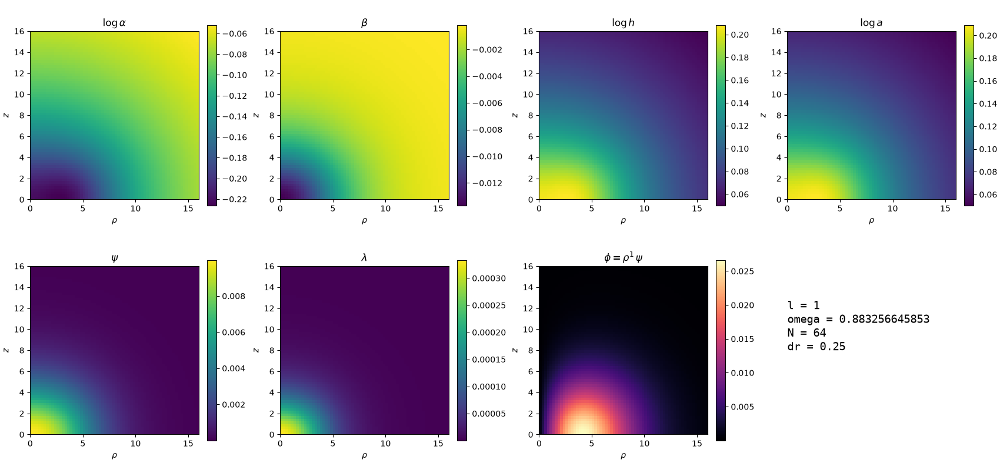
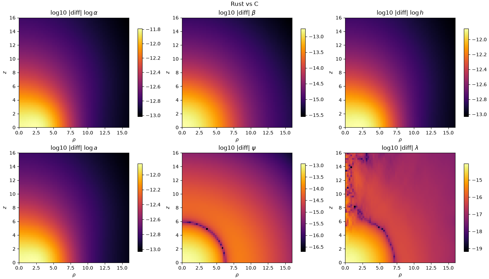

# A0 demo: an l=1 boson star, solved from scratch in Rust

The Rust solver (Newton with the block-field Krylov linear solver) solves the l=1 fixedPhi problem at N=64 (dr = dz = 0.25) from the Gaussian ansatz. The C oracle solves the same problem (`configs/l1_fixedphi_n64.toml`). They agree to about 1e-12, the size of the Newton tolerance.

## Reproduce

    cd ng && cargo run --release -p rbs-elliptic --example l1_star -- ../out/demo/a0/rust
    mkdir -p out/demo/a0/c && cd out/demo/a0/c && source /opt/intel/oneapi/setvars.sh && ../../../../build/release/ROTBOSON ../../../../configs/l1_fixedphi_n64.toml
    uv run tools/plot_star.py fields out/demo/a0/rust/solution.txt --output docs/results/figures/a0_l1_star_fields.png
    uv run tools/plot_star.py compare out/demo/a0/rust/solution.txt "out/demo/a0/c/l=1,w=8.83257E-01,dr=2.50000E-01,N=0064/solution.h5" --labels Rust C --output docs/results/figures/a0_l1_rust_vs_c.png

To look at the star in 3D, open `out/demo/a0/rust/solution.vtr` in ParaView.

## The Rust solve

    l=1 star, N=64, dr=dz=0.25, backend Krylov
      iter  0: |du| 6.418e1  RejectB
      iter  0: |du| 4.155e-1  EnterQnerr
      iter  1: |du| 0.000e0  ExitQnerr
      iter  2: |du| 3.114e-2  RejectA
      iter  2: |du| 3.104e-2  Accept
      iter  3: |du| 3.954e-2  Accept
      iter  4: |du| 9.719e-3  EnterQnerr
      iter  5: |du| 9.503e-5  QnerrAccept
      iter  6: |du| 1.003e-5  QnerrAccept
      iter  7: |du| 1.059e-7  QnerrAccept
      iter  8: |du| 6.705e-9  QnerrAccept
      iter  9: |du| 2.051e-10  QnerrAccept
      iter 10: |du| 4.024e-13  ConvergedC
    converged in 11 Newton iterations, 7.2 s
    omega = 0.883256645852585

## The star

psi is the regularized scalar field. The physical field is phi = rho^l psi, which vanishes on the axis for l >= 1 (bottom row, third panel).

## Rust against C

    omega Rust 0.8832566458525849  C 0.883256645851883  rel diff 7.947e-13
    log_alpha_f  max|diff| 1.616e-12  max|field| 2.262e-01
    beta_f       max|diff| 1.778e-13  max|field| 1.369e-02
    log_h_f      max|diff| 1.395e-12  max|field| 2.083e-01
    log_a_f      max|diff| 1.402e-12  max|field| 2.092e-01
    psi_f        max|diff| 1.168e-13  max|field| 9.990e-03
    lambda_f     max|diff| 8.833e-15  max|field| 3.334e-04
