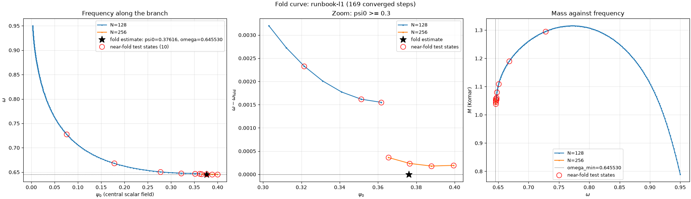
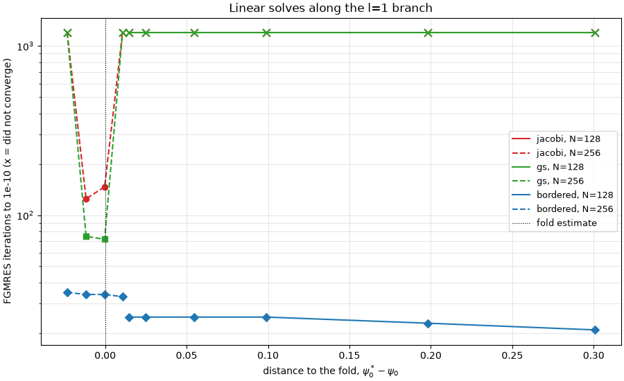
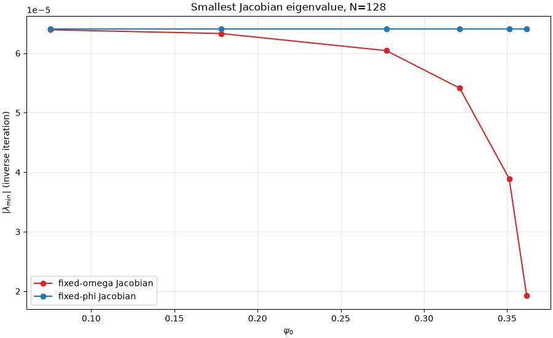

# A0.5 near-fold results

Date: 2026-11-27
Commit: a7c3cb1

## Figures

## linear, N=128

| N | step | psi0 | dist | self_check_residual | solver | threads | iterations | converged | residual | rel_error | factor_s | solve_s |
|---|---|---|---|---|---|---|---|---|---|---|---|---|
| 128 | 111 | 0.07553040721236956 | 0.30062783107456015 | 1.160e-13 | jacobi | 8 | 1200 | false | 1.044e-1 | 1.676e-1 | 0.983 | 32.134 |
| 128 | 111 | 0.07553040721236956 | 0.30062783107456015 | 1.160e-13 | bordered | 8 | 21 | true | 6.032e-11 | 8.953e-10 | 1.024 | 0.564 |
| 128 | 111 | 0.07553040721236956 | 0.30062783107456015 | 1.160e-13 | gs | 8 | 1200 | false | 7.370e3 | 2.880e3 | 0.989 | 34.202 |
| 128 | 111 | 0.07553040721236956 | 0.30062783107456015 | 1.160e-13 | lu | 8 | 0 | true | 1.905e-12 | 2.448e-12 | 4.721 | 0.075 |
| 128 | 140 | 0.17802488051661336 | 0.19813335777031632 | 4.549e-11 | jacobi | 8 | 1200 | false | 1.547e2 | 7.389e1 | 1.107 | 30.684 |
| 128 | 140 | 0.17802488051661336 | 0.19813335777031632 | 4.549e-11 | bordered | 8 | 23 | true | 7.224e-11 | 4.355e-9 | 0.910 | 0.581 |
| 128 | 140 | 0.17802488051661336 | 0.19813335777031632 | 4.549e-11 | gs | 8 | 1200 | false | 1.707e11 | 3.001e10 | 0.938 | 33.163 |
| 128 | 140 | 0.17802488051661336 | 0.19813335777031632 | 4.549e-11 | lu | 8 | 0 | true | 7.385e-13 | 5.318e-12 | 4.728 | 0.073 |
| 128 | 155 | 0.2773575079849023 | 0.0988007303020274 | 6.873e-13 | jacobi | 8 | 1200 | false | 2.123e4 | 1.115e4 | 1.039 | 30.663 |
| 128 | 155 | 0.2773575079849023 | 0.0988007303020274 | 6.873e-13 | bordered | 8 | 25 | true | 2.797e-11 | 5.064e-10 | 0.963 | 0.616 |
| 128 | 155 | 0.2773575079849023 | 0.0988007303020274 | 6.873e-13 | gs | 8 | 1200 | false | 2.271e10 | 1.474e10 | 0.993 | 33.297 |
| 128 | 155 | 0.2773575079849023 | 0.0988007303020274 | 6.873e-13 | lu | 8 | 0 | true | 4.418e-13 | 5.325e-12 | 4.585 | 0.077 |
| 128 | 160 | 0.3214887767260417 | 0.05466946156088798 | 2.668e-13 | jacobi | 8 | 1200 | false | 1.135e6 | 1.380e5 | 1.027 | 30.531 |
| 128 | 160 | 0.3214887767260417 | 0.05466946156088798 | 2.668e-13 | bordered | 8 | 25 | true | 3.680e-11 | 1.740e-9 | 0.919 | 0.637 |
| 128 | 160 | 0.3214887767260417 | 0.05466946156088798 | 2.668e-13 | gs | 8 | 1200 | false | 1.218e6 | 9.544e5 | 0.969 | 32.742 |
| 128 | 160 | 0.3214887767260417 | 0.05466946156088798 | 2.668e-13 | lu | 8 | 0 | true | 3.431e-13 | 3.691e-12 | 4.879 | 0.079 |
| 128 | 163 | 0.35124211951296563 | 0.024916118773964047 | 1.211e-11 | jacobi | 8 | 1200 | false | 8.529e6 | 9.832e5 | 1.012 | 30.666 |
| 128 | 163 | 0.35124211951296563 | 0.024916118773964047 | 1.211e-11 | bordered | 8 | 25 | true | 5.589e-11 | 2.671e-9 | 0.922 | 0.596 |
| 128 | 163 | 0.35124211951296563 | 0.024916118773964047 | 1.211e-11 | gs | 8 | 1200 | false | 2.157e11 | 6.317e10 | 0.933 | 32.604 |
| 128 | 163 | 0.35124211951296563 | 0.024916118773964047 | 1.211e-11 | lu | 8 | 0 | true | 9.554e-14 | 2.045e-12 | 5.197 | 0.075 |
| 128 | 164 | 0.36175303195152353 | 0.014405206335406151 | 2.005e-11 | jacobi | 8 | 1200 | false | 2.091e6 | 5.838e5 | 0.984 | 31.397 |
| 128 | 164 | 0.36175303195152353 | 0.014405206335406151 | 2.005e-11 | bordered | 8 | 25 | true | 5.770e-11 | 2.409e-9 | 0.929 | 0.640 |
| 128 | 164 | 0.36175303195152353 | 0.014405206335406151 | 2.005e-11 | gs | 8 | 1200 | false | 2.679e11 | 1.844e10 | 0.968 | 32.755 |
| 128 | 164 | 0.36175303195152353 | 0.014405206335406151 | 2.005e-11 | lu | 8 | 0 | true | 6.910e-14 | 4.331e-12 | 5.040 | 0.120 |

## linear, N=256

| N | step | psi0 | dist | self_check_residual | solver | threads | iterations | converged | residual | rel_error | factor_s | solve_s |
|---|---|---|---|---|---|---|---|---|---|---|---|---|
| 256 | 165 | 0.3654840050702929 | 0.010674233216636797 | 5.099e-12 | jacobi | 8 | 1200 | false | 8.126e3 | 5.545e2 | 4.707 | 187.270 |
| 256 | 165 | 0.3654840050702929 | 0.010674233216636797 | 5.099e-12 | bordered | 8 | 33 | true | 9.349e-11 | 7.762e-10 | 4.605 | 5.230 |
| 256 | 165 | 0.3654840050702929 | 0.010674233216636797 | 5.099e-12 | gs | 8 | 1200 | false | 3.744e4 | 8.950e3 | 4.716 | 192.556 |
| 256 | 166 | 0.37651056457551846 | -0.0003523262885887779 | 2.063e-10 | jacobi | 8 | 147 | true | 6.595e-11 | 3.910e-10 | 4.949 | 23.101 |
| 256 | 166 | 0.37651056457551846 | -0.0003523262885887779 | 2.063e-10 | bordered | 8 | 34 | true | 6.636e-11 | 6.965e-10 | 5.049 | 5.559 |
| 256 | 166 | 0.37651056457551846 | -0.0003523262885887779 | 2.063e-10 | gs | 8 | 72 | true | 8.948e-11 | 1.224e-9 | 4.754 | 11.607 |
| 256 | 167 | 0.38787202534440235 | -0.011713787057472669 | 2.616e-10 | jacobi | 8 | 125 | true | 8.606e-11 | 4.112e-10 | 4.522 | 18.632 |
| 256 | 167 | 0.38787202534440235 | -0.011713787057472669 | 2.616e-10 | bordered | 8 | 34 | true | 6.621e-11 | 8.657e-10 | 4.735 | 4.904 |
| 256 | 167 | 0.38787202534440235 | -0.011713787057472669 | 2.616e-10 | gs | 8 | 75 | true | 9.337e-11 | 1.765e-9 | 4.612 | 12.296 |
| 256 | 168 | 0.3995124194624178 | -0.023354181175488098 | 4.291e-12 | jacobi | 8 | 1200 | false | 1.163e3 | 2.311e2 | 4.263 | 184.685 |
| 256 | 168 | 0.3995124194624178 | -0.023354181175488098 | 4.291e-12 | bordered | 8 | 35 | true | 9.864e-11 | 1.169e-9 | 4.843 | 6.137 |
| 256 | 168 | 0.3995124194624178 | -0.023354181175488098 | 4.291e-12 | gs | 8 | 1200 | false | 6.610e10 | 2.915e10 | 4.857 | 189.000 |

## stale

| N | step | psi0 | dist | self_check_residual | solver | threads | factored_at_step | stale_iterations | stale_converged | stale_residual | fresh_iterations | fresh_converged |
|---|---|---|---|---|---|---|---|---|---|---|---|---|
| 128 | 111 | 0.07553040721236956 | 0.30062783107456015 | 1.160e-13 | bordered | 8 | 111 | 21 | true | 6.032e-11 | 21 | true |
| 128 | 140 | 0.17802488051661336 | 0.19813335777031632 | 4.549e-11 | bordered | 8 | 111 | 24 | true | 9.863e-11 | 23 | true |
| 128 | 155 | 0.2773575079849023 | 0.0988007303020274 | 6.873e-13 | bordered | 8 | 111 | 28 | true | 3.196e-11 | 25 | true |
| 128 | 160 | 0.3214887767260417 | 0.05466946156088798 | 2.668e-13 | bordered | 8 | 111 | 29 | true | 2.050e-11 | 25 | true |
| 128 | 163 | 0.35124211951296563 | 0.024916118773964047 | 1.211e-11 | bordered | 8 | 111 | 29 | true | 4.132e-11 | 25 | true |
| 128 | 164 | 0.36175303195152353 | 0.014405206335406151 | 2.005e-11 | bordered | 8 | 111 | 29 | true | 5.450e-11 | 25 | true |
| 256 | 165 | 0.3654840050702929 | 0.010674233216636797 | 5.099e-12 | bordered | 8 | 168 | 34 | true | 5.965e-11 | 33 | true |
| 256 | 166 | 0.37651056457551846 | -0.0003523262885887779 | 2.063e-10 | bordered | 8 | 168 | 34 | true | 5.551e-11 | 34 | true |
| 256 | 167 | 0.38787202534440235 | -0.011713787057472669 | 2.616e-10 | bordered | 8 | 168 | 34 | true | 5.600e-11 | 34 | true |
| 256 | 168 | 0.3995124194624178 | -0.023354181175488098 | 4.291e-12 | bordered | 8 | 168 | 35 | true | 9.864e-11 | 35 | true |

## newton

| N | step | psi0 | dist | self_check_residual | solver | threads | start_step | status | newton_iterations | linear_solves | krylov_iterations | omega | omega_c | max_rel_field_diff | worst_field | max_rel_field_diff_interior | worst_field_interior | seconds |
|---|---|---|---|---|---|---|---|---|---|---|---|---|---|---|---|---|---|---|
| 128 | 164 | 0.36175303195152353 | 0.014405206335406151 | 2.005e-11 | bordered | 8 | 163 | converged | 5 | 11 | 212 | 0.647079629955808 | 0.6470796299558079 | 2.932e-2 | psi | 3.363e-12 | lambda | 7.8 |
| 256 | 166 | 0.37651056457551846 | -0.0003523262885887779 | 2.063e-10 | bordered | 8 | 167 | converged | 4 | 8 | 152 | 0.6457644139468055 | 0.6457644139507639 | 3.000e-2 | psi | 4.116e-11 | lambda | 34.0 |

## eig

| N | step | psi0 | dist | self_check_residual | threads | lambda_fixed_omega | iterations_fixed_omega | converged_fixed_omega | lambda_fixed_phi | iterations_fixed_phi | converged_fixed_phi | seconds |
|---|---|---|---|---|---|---|---|---|---|---|---|---|
| 128 | 111 | 0.07553040721236956 | 0.30062783107456015 | 1.160e-13 | 8 | 6.393550e-5 | 24 | true | 6.406351e-5 | 30 | false | 18.6 |
| 128 | 140 | 0.17802488051661336 | 0.19813335777031632 | 4.549e-11 | 8 | 6.330758e-5 | 30 | false | 6.406176e-5 | 30 | false | 18.4 |
| 128 | 155 | 0.2773575079849023 | 0.0988007303020274 | 6.873e-13 | 8 | 6.043319e-5 | 30 | false | 6.406299e-5 | 30 | false | 17.1 |
| 128 | 160 | 0.3214887767260417 | 0.05466946156088798 | 2.668e-13 | 8 | 5.413272e-5 | 30 | false | 6.406328e-5 | 30 | false | 17.6 |
| 128 | 163 | 0.35124211951296563 | 0.024916118773964047 | 1.211e-11 | 8 | 3.893303e-5 | 23 | true | 6.406337e-5 | 30 | false | 16.1 |
| 128 | 164 | 0.36175303195152353 | 0.014405206335406151 | 2.005e-11 | 8 | 1.925510e-5 | 25 | true | 6.406339e-5 | 30 | false | 16.4 |

## Failures

None
